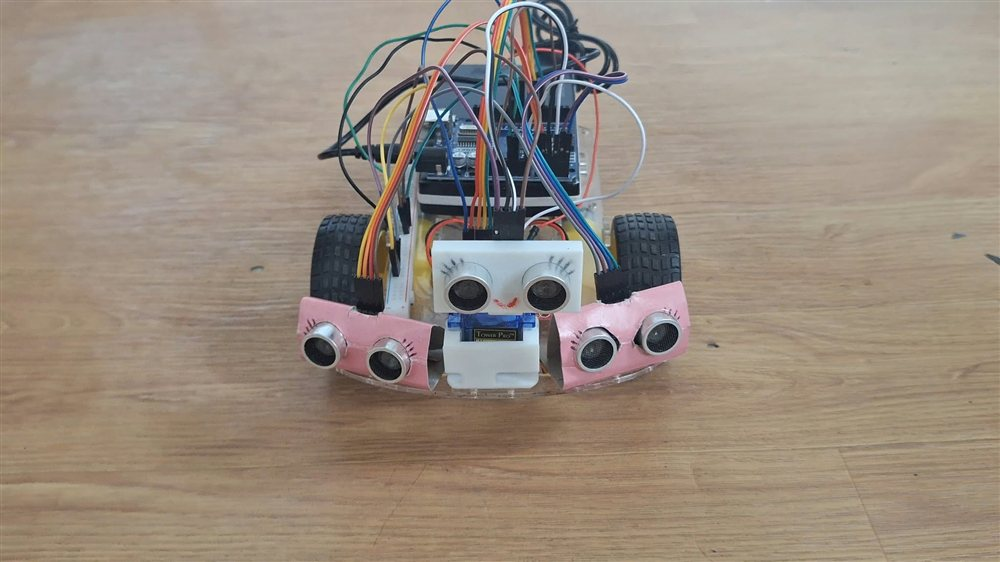

# Fuzzy Logic Obstacle Avoidance Robot

## Overview

Two Arduino implementations of reactive obstacle avoidance: a servo-scanned single ultrasonic sensor and a three-sensor fuzzy controller.

## Objectives

- Servo-scanned one-sensor variant
- Three-sensor variant
- Forward/reverse/turn control

## Technologies Used

Arduino C++, NewPing, Servo, Fuzzy.h, Ultrasonic sensors.

## Methodology and Implementation

- Single-sensor version scans left/right with a servo and computes near/far memberships over the 20–50 cm transition. A dominant-rule function returns a direction.
- Three-sensor version uses NewPing for left/front/right ranges, Fuzzy.h memberships and four rules; defuzzification selects forward, turn, reverse or stop branches.
- Three-sensor code maps no-echo readings to 200 cm and updates after a 300 ms delay. Two PWM motor channels drive the chassis.

## Results and Outputs

- Two separate source implementations define distance-based motor control. The provided photograph shows three forward-facing ultrasonic modules.
- A local group video exists; no quantified collision rate, route-completion rate or navigation-time benchmark is documented.

## Limitations

- In the single-sensor caller, every fuzzy decision other than RIGHT becomes a left turn, including FORWARD and REVERSE.
- PWM use on A3/A4 in the single-sensor sketch needs checking against the actual board; no-echo-as-far behavior needs hardware testing.
- Individual roles are not stated in the available source files. Video sharing rights and participant permissions are unconfirmed.

## Contributors

Collaborative academic project by Tischia Ann Olivares, Michelle Tercero and Rona Mae Quite, confirmed by the author. Individual task assignments are not documented.

## Prototype Photograph

Supplied project photograph of the three-ultrasonic-sensor prototype.

## Repository

[View Repository](https://github.com/chiaseedss/fuzzy-obstacle-avoidance)
